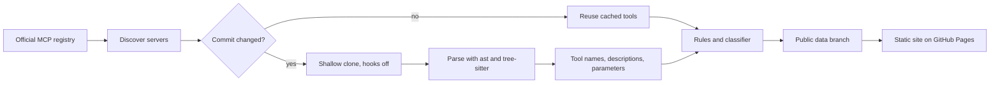

# MCP Watcher

MCP Watcher reads the source code of every public server in the official MCP registry each day and marks tool descriptions that could steer an AI assistant against the person using it. Every MCP tool ships with a description that the model reads and the user rarely sees, which makes that text a quiet place to hide instructions. Each flag on the site shows the exact words that raised it, the rule or model that fired, and a link to the source line.

The live site is at **https://rohitdurbha.github.io/mcp-watcher/**, and it refreshes every morning.

## How it works



The daily workflow checks about thirty thousand linked repositories, clones only the ones whose commit changed, and parses Python, TypeScript, JavaScript and Go without installing or running anything. The extractor follows constants across files to rebuild descriptions that are assembled in code, and it recovers the full text for more than 99 percent of tools. Explainable rules look for the patterns that published attacks rely on, and a logistic regression classifier over TF-IDF features and the rule signals adds a second opinion.

## Results

On sixteen real published attacks that were never used in training, flags plus the classifier only tier catch 14, while raising one benign tool in 529 from curated benchmark repositories. The model card in `docs/model_card.md` gives confidence intervals, a test that holds out each attack family in turn, and the two attacks that nothing catches.

Curated benchmarks flatter any detector, so Phase 6 also read 100 live flags by hand. Only about one flag in nine deserved a human look, and the misses followed clear patterns such as negated sentences, documentation tags and tools whose job is SSH or agent setup. The rules were narrowed against those patterns with regression tests, and classifier flags with no rule evidence moved to a separate tier that is listed for review but never counted. The review lives in `datasets/registry_review_a.json`, and a fresh sample drawn after the changes measures the new precision honestly.

## Data

The `data` branch of this repository holds the public files from the latest run. They are the server list, the run state for every registry entry, a summary, one line of history per day, and every flagged tool with its text and evidence. The site reads small JSON files built from that branch, and `site/llms.txt` describes them for AI agents. Credential-looking strings are removed before anything is published, and the full per-tool output stays in the workflow cache because it is too large for a git branch.

## Disputes

Scores from this project are automated risk signals and never a verdict on any author. Every flag page links to a GitHub issue form, and a disputed flag stays visible with a note until a person reviews it and either confirms or clears it. Every reviewed decision is recorded in `datasets/disputes.json` so anyone can read it.

## Related work

Several projects study the same problem from other angles, and this one is meant to sit beside them. Invariant Labs first described tool poisoning and maintains `mcp-scan`, which checks the servers on one machine, and Cisco publishes an MCP scanner with example malicious servers that this project uses as test data. MCPTox and the OWASP MCP Top 10 describe the attack families behind the synthetic training templates. Academic work has measured the ecosystem at scale, including "Mind Your Server" (arXiv 2509.06572), "A First Look at the Security Issues in the Model Context Protocol Ecosystem" (arXiv 2510.16558), a study of supply chain attacks across about 200,000 servers (arXiv 2605.04421) and a dynamic assessment of internet-facing servers (arXiv 2608.00150).

An unrelated project called MCP Sentinel by soy-rafa protects a single Claude Code setup by blocking risky tool calls as they happen. This project was named mcp-sentinel before that overlap came to light, and it was renamed to avoid any confusion. MCP Watcher differs from the tools above by covering the whole public registry every day from source code, by publishing open data with evidence for every flag, and by testing its classifier on real attacks it never saw and on its own live flags.

## Limits

The scan reads source code on the default branch, so tools generated at runtime, shipped only in packages, or rewritten after startup can be missed. Servers without a public repository cannot be scanned at all. The real attack test set is small, so its numbers carry wide uncertainty, and the live review is the better guide to how often a flag deserves attention.

## Quick start

```bash
uv venv && uv pip install -e ".[dev,ml]"
mcp-watcher discover --out data/servers.jsonl
mcp-watcher extract --repo https://github.com/modelcontextprotocol/servers --out data/one.jsonl
mcp-watcher scan --tools data/one.jsonl --out data/findings.jsonl --model models/watcher-lr-2.pkl
mcp-watcher pipeline --out out --model models/watcher-lr-2.pkl --limit 50
pytest
```

The phases and their exit checks live in `docs/PLAN.md`, the rule review in `docs/signals_review.md`, and the classifier details in `docs/model_card.md`.

## License

The code is released under the MIT license, so you are free to use it, change it and share it.
